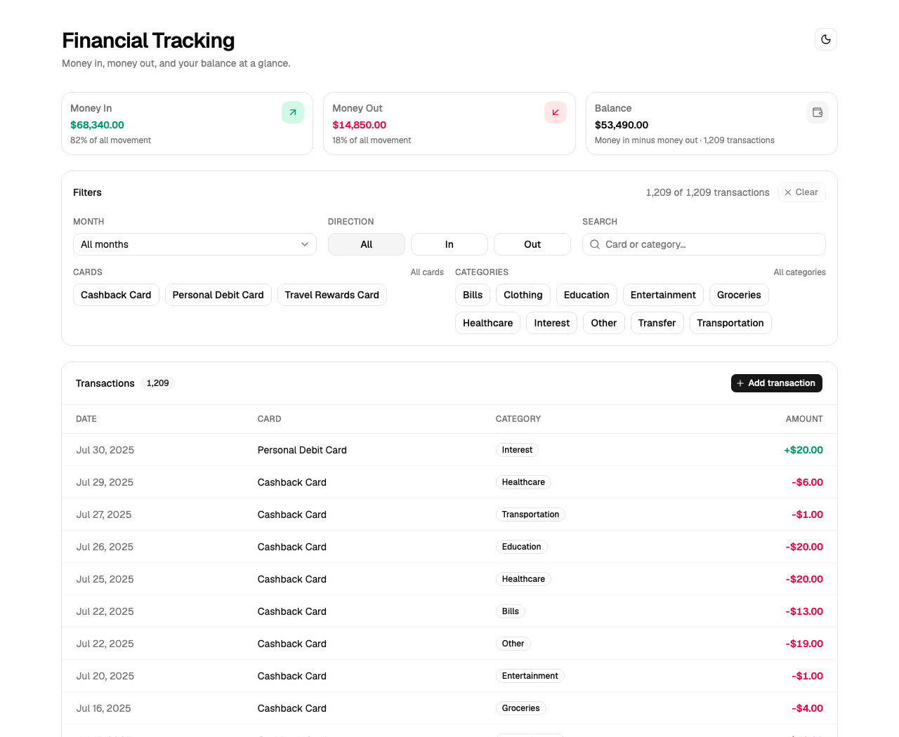
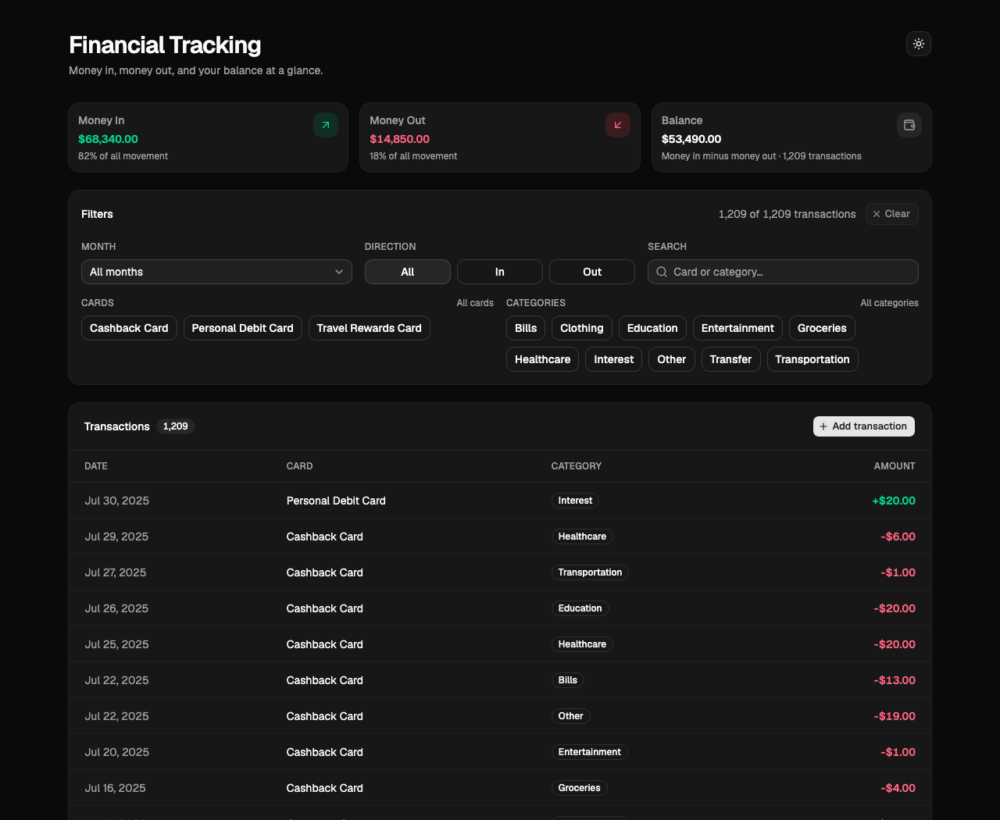

# Financial Tracking App

A small financial dashboard: summarise money in / money out / balance, filter a
transaction ledger, and manage transactions through a REST API.

Built as an exercise project — the point is a readable, well-factored React
codebase rather than feature volume.



<details>
<summary>Dark theme</summary>



</details>

---

## Features

- **Summary cards** — Money In, Money Out and Balance, recalculated from the
  *filtered* set, with each direction's share of total movement.
- **Filtering** — month (only months that actually contain data), direction
  (in / out / all), free-text search, and multi-select cards and categories.
  All filters combine with AND and apply to both the table and the summary.
- **Transaction table** — newest first, hand-rolled `<table>` (not the shadcn
  DataTable recipe), with an empty state and horizontal scroll on small screens.
- **Create** — add a transaction through a validated dialog.
- **Light / dark theme** — token-based, persisted, respects the OS preference.
- **Works offline** — if the API is not running the UI falls back to bundled
  seed data, so a single `npm run dev` is enough to demo it.

## Tech stack

| Layer | Choice |
| --- | --- |
| UI | React 19, TypeScript, Vite 8 |
| Styling | Tailwind CSS v4 + shadcn/ui (`radix` base, `nova` preset, Geist, lucide) |
| Dates | dayjs |
| API | Node.js, Express 5, zod |
| Lint | oxlint |

---

## Getting started

```bash
# 1. Frontend (works on its own)
cd frontend
npm install
npm run dev            # http://localhost:5173

# 2. API (optional, but this is where CRUD lives)
cd ../backend
npm install
cp .env.example .env   # DATABASE_URL + PORT
npm run seed           # reset the JSON data store from the pristine seed
npm run dev            # http://localhost:3001
```

Vite proxies `/api` to `:3001`, so there is no CORS setup in development.

## API

Base URL `http://localhost:3001`.

| Method | Path | Status |
| --- | --- | --- |
| `GET` | `/api/health` | ✅ |
| `GET` | `/api/transactions` | ✅ supports `month`, `card`, `category`, `direction`, `search` |
| `GET` | `/api/transactions/:id` | ✅ |
| `POST` | `/api/transactions` | ✅ zod-validated, `400` on invalid body |
| `GET` | `/api/cards` | ✅ distinct card names |
| `GET` | `/api/categories` | ✅ distinct categories |
| `PATCH` | `/api/transactions/:id` | ⬜ **your task** — `501` stub |
| `DELETE` | `/api/transactions/:id` | ⬜ **your task** — `501` stub |

Errors use `{ "error": { "message": string, "details"?: unknown } }`.

Data lives in `backend/src/data/transactions.json` (gitignored, mutable). It is
created on first run from the committed `seed.json`, and `npm run seed` resets
it. `store.js` persists with an atomic write.

## Database (Prisma + Postgres)

The Postgres/Prisma scaffolding is in place and the connection is verified, but
the **API does not use it yet** — it still reads the JSON store above. Moving it
across is [DATABASE-EXERCISE.md](DATABASE-EXERCISE.md).

| Thing | Where |
| --- | --- |
| Prisma 7.10.0 + `@prisma/adapter-pg` | `backend/` (pinned — `prisma@latest` is an `8.0.0-rc`) |
| `DATABASE_URL` | `backend/.env` (gitignored) — see `.env.example` |
| Prisma 7 config | `backend/prisma7.config.ts` |
| Schema | `backend/prisma/schema.prisma` — **model deliberately left as a TODO** |
| Client singleton | `backend/src/db.js` |
| Database | local Postgres 17 (`financial_tracking`) |

```bash
cd backend
npm run db:studio     # browse data
npm run db:migrate    # create + apply a migration
npm run db:generate   # regenerate the client after a schema change
```

`npm run db:generate` already succeeds with no models — the connection works,
the client just has no model delegates yet. So you can verify your setup before
writing any schema:

```bash
node --input-type=module -e "import('./src/db.js').then(async (m) => {
  console.log(await m.prisma.\$queryRaw\`select current_database()\`)
  await m.disconnectPrisma() })"
```

---

## Project structure

```
financial-tracking-app/
├── requirements.md          # the original exercise brief
├── CRUD-EXERCISE.md         # the remaining PATCH/DELETE + edit/delete tasks
├── DATABASE-EXERCISE.md     # the Postgres + Prisma migration tasks
├── transaction.json         # pristine 1209-row seed (source of truth)
├── docs/                    # screenshots
├── frontend/
│   └── src/
│       ├── components/      # see frontend/README.md for the full tree
│       ├── lib/             # api seam + shared money logic
│       ├── types/           # Transaction, FilterState, Summary
│       └── App.tsx          # owns ALL app state
└── backend/
    ├── prisma/schema.prisma # model left as a TODO (see DATABASE-EXERCISE.md)
    ├── prisma7.config.ts    # Prisma 7 config; loads .env
    └── src/
        ├── index.js         # Express app, error handling
        ├── store.js         # in-memory + atomic JSON persistence
        ├── db.js            # Prisma client singleton (not wired up yet)
        ├── schema.js        # zod schemas
        ├── routes/          # /api/transactions
        └── data/            # seed.json (committed) + transactions.json (live)
```

## Architecture notes

**State lives in `App.tsx`.** `transactions`, `filterState` and `theme` are all
owned by the root component and passed down as props — no context, no store.
`requirements.md` §3 documents the two deliberate exceptions.

**The summary is derived, not stored.** An earlier version kept `moneyIn` /
`moneyOut` / `balance` in `useState` and updated them from a `useEffect`. Because
the filter step returned a fresh array each render, that effect re-ran
constantly. It is now a `useMemo` over the filtered rows, which is both correct
and cheaper.

**`lib/api.ts` is the only door to the backend.** `App.tsx` never calls `fetch`.
Swapping the seed for the live API — or the other way round — is a change in one
file.

**`TransactionTable` stays a plain `<table>`.** That is intentional: the brief
asks for a hand-rolled table rather than the TanStack-based shadcn DataTable.

## Roadmap

- [ ] `PATCH` / `DELETE` endpoints and the edit/delete UI — see
      [CRUD-EXERCISE.md](CRUD-EXERCISE.md)
- [ ] Move the data from the JSON store into Postgres via Prisma — see
      [DATABASE-EXERCISE.md](DATABASE-EXERCISE.md)
- [ ] Optimistic delete with undo (`useOptimistic`)
- [ ] Bulk select and bulk actions
- [ ] CSV import / export of the filtered rows
- [ ] Charts: spend by category, money in vs out over time (`shadcn/chart`)
- [ ] Server-side pagination / virtual scrolling for the 1,209 rows
- [ ] Tests: Vitest for `applyFilters` / `computeMoney`, Playwright for the CRUD flow
- [ ] Code-split the create dialog — `react-day-picker` is the largest
      contributor to the ~185 kB gzipped bundle
